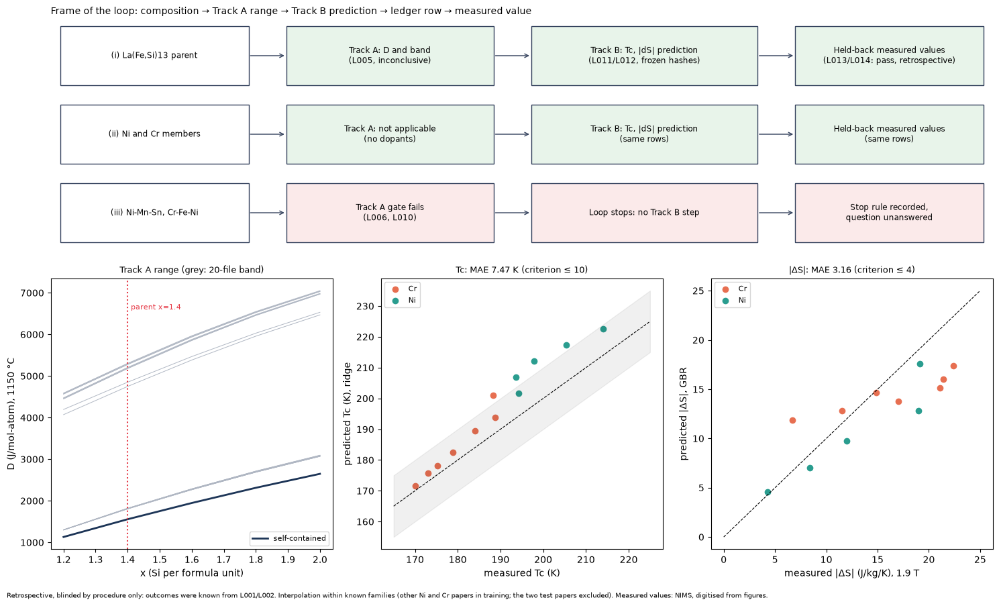

# Loop worked example

One composition family followed through the whole loop: **composition → Track A range → Track B prediction → ledger row → held-back measured value**. The example is La(Fe,Si)₁₃ (parent LaFe₁₁.₆Si₁.₄) with its Ni and Cr members, and the same figure shows where the loop stopped for two other systems.

## What it shows
- **Parent:** Track A gives a range for the CALPHAD driving-force descriptor D (1556 J/mol-atom at x = 1.4, 1150 °C; the 20-file band spans 1556–5304 and splits by La–Si file). Its validity test was inconclusive (ledger L005), and D is not used in the prediction.
- **Ni and Cr members:** Track A is not applicable (no dopants). Track B predicts Tc and |ΔS| from composition.
- **Held-back step:** predictions were written first (frozen, sha256 in `data/manifest.json`), then joined to the 12 measured values. Tc MAE 7.47 K (criterion ≤ 10 K), |ΔS| MAE 3.16 J/kg/K (criterion ≤ 4). Both pass (L013, L014; the frozen predictions are L011, L012).
- **Where the loop stops:** Ni–Mn–Sn and Cr–Fe–Ni failed their pre-registered Track A gates (L006, L010). The stop rule fired and is recorded.

## Read this before quoting the numbers
This is a **retrospective** example. The 12 measured values were already evaluated on 12 Nov (L001/L002), the thresholds were set after those baselines, and the blind is procedural only. The result is a demonstration of the procedure, not new evidence about the model.
- The test is interpolation within known families: other Ni and Cr papers in NIMS are in the training data; the two test papers are excluded.
- The measured values are the NIMS records, digitised from the figures of the papers. For 5 Tc values (Ni series) and 7 |ΔS| values (Cr series) the papers give fit-law values; using those instead gives Tc MAE 7.77 K and |ΔS| MAE 3.12, both still pass. The other points are not tabulated in the papers.
- Cr members are labelled by the EDX Cr content of the paper (Table 1), not by a nominal composition; the Ni members are nominal.

Details: `Heldout_Blinded_Criteria_20261123.md`.

## Files
| File | Role |
|---|---|
| `loop_worked_example.ipynb` | the walk-through; run top to bottom |
| `loop_worked_example.png` | the figure |
| `src/blinded_heldout_predict.py` | writes the predictions without the measured column, plus the pending ledger rows |
| `src/join_measured.py` | checks the hashes, joins the measured values, prints MAE and the flag |
| `data/` | frozen predictions, manifest, descriptor tables, measured values, ledger CSVs |
| `Heldout_Blinded_Criteria_20261123.md` | criteria, limits and frozen hashes, written before the join |
| `Heldout_12_Measured_Values_20261123.md` | the 12 measured values and their references |
| `Loop_Worked_Example_Result_20261123.md` | short result note |

## Hashes (sha256, checked 23 Nov 2026)
| File | sha256 |
|---|---|
| `src/blinded_heldout_predict.py` | c937bbc0061eaa9d8836cbb554d9e7639cd27f98223a4ea40b8efa6f5d1fe8d3 |
| `src/join_measured.py` | 309ca3612633ac6102ceaa80df0e2a472fc43e2a760c958c10a553648e186a70 |
| `data/predictions_T_tr.csv` | 53871390dbb45cdfd867b5eddcb9b901eba43cc7079c8952de19b63063c2e1a5 |
| `data/predictions_dS.csv` | 1ad59cef1bad3ca2b43d065ca42e9a8abfe5fdc44d2a87cbdd5ae8559048dafe |
| `data/manifest.json` | 94ba36d60327af218ca3a8df760e9408885e74fe01ec7dcf1a02e39b6f72dc1d |
| `evaluate.py` (in `stage_four/mce_nims/`) | 539d143c…8b68e (full value in the criteria note) |

Check with `shasum -a 256 <file>`.

## Run
Open the notebook in this folder and run all cells (Python 3 with pandas, numpy, matplotlib). The first cell stops if the frozen predictions no longer match the manifest. Regenerating the predictions needs `evaluate.py`, `nims_dataset.py`, `composition_key.py` and the NIMS file `1-13_dataset.xlsx` (DOI 10.48505/nims.4909) from `stage_four/mce_nims/`. The run of 23 Nov used Python 3.13, scikit-learn 1.9.1, numpy 2.5.3, pandas 3.0.5.

## Acknowledgements
The measured values are from the published work of L. M. Moreno-Ramírez, V. Franco and co-authors (Acta Mater. 160 (2018) 137, doi:10.1016/j.actamat.2018.08.054; Acta Mater. 175 (2019) 406, doi:10.1016/j.actamat.2019.06.022), as recorded in the NIMS database. We thank V. Franco and L. M. Moreno-Ramírez for discussion. Training data: NIMS La(Fe,Si)₁₃ dataset (CC BY 4.0).
